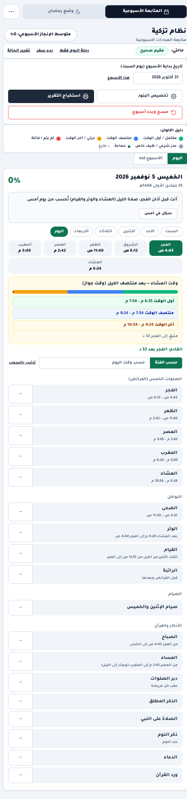

# نظام تزكية — متابعة العبادات الأسبوعية

**متابعة العبادات الأسبوعية (صلوات، نوافل، صيام، أذكار) لمستخدم واحد، بحساب أوقات الصلاة هجريًّا وميلاديًّا على الجهاز نفسه — بدون إنترنت، بدون حساب، وبدون أي خادم.**

**🔗 جرّبه الآن: <https://abedmohamed258.github.io/tazkiyah/>** — افتح الرابط وسجّل، ثم من قائمة المتصفح اختر «تثبيت التطبيق» ليعمل بلا إنترنت تمامًا.



---

## بياناتك لا تغادر الجهاز — والإثبات في الكود

- **سياسة CSP صارمة** في رأس `index.html`: `default-src 'none'` و`connect-src 'self' data: blob:` — أي طلب شبكة صادر من الصفحة مسموح لنفس النطاق فقط، ولا يوجد أصلًا أي `fetch` لنطاق خارجي في الكود.
- **التخزين كله في `localStorage`** (لا يُستخدم IndexedDB) بمفاتيح واضحة: `TazkiyahSystem_v7` للأسبوع الحالي، `TazkiyahSystem_v7_settings` للإعدادات، `TazkiyahSystem_Ramadan_v1` لوضع رمضان، `TazkiyahSystem_v7_qada` للفوائت والقضاء، `TazkiyahSystem_v7_archive` للأرشيف، `TazkiyahSystem_v7_mode` و`TazkiyahSystem_v7_lastBackup` و`TazkiyahSystem_helpSeen`.
- **لا حسابات ولا تحليلات ولا خوادم**: التطبيق ملف HTML واحد يعمل حتى من ملف محلي.
- الاستثناء الوحيد بيدك أنت: زر «مشاركة → واتساب» يفتح رابط `wa.me` في تبويب جديد بالنص الذي اختارته أنت، وزر الطباعة يستخدم طباعة المتصفح. لا شيء يُرسل تلقائيًا.

## المزايا

- **شبكة أسبوع سبت ← جمعة**: كل يوم في صف، وكل بند في عمود، مع تلوين فوري للحالات وحساب نسبة الإنجاز الأسبوعية.
- **خمس حالات لكل بند**: أول الوقت (أخضر) / منتصف الوقت (أزرق) / آخر الوقت (أصفر) / فاتتني-أقضيها (أحمر) / عذر شرعي (رمادي).
- **الصلوات الخمس** مع تعليم «جماعة»، و**النوافل**: الضحى والوتر والقيام والراتبة (تفصيل راتبة الظهر والعصر والمغرب والعشاء والفجر).
- **الصيام**: صيام الاثنين والخميس، الأيام البيض (بحساب اليوم الهجري)، عاشوراء وتاسوعاء، يوم عرفة، الست من شوال، صيام داود، شعبان، المحرَّم، تسع ذي الحجة، وقضاء رمضان — بعضها اختياري/تلقائي التفعيل حسب التاريخ الهجري.
- **الأذكار والقرآن**: أذكار الصباح والمساء، الأذكار دبر الصلوات، الذكر المطلق، الصلاة على النبي، ذكر النوم، الدعاء، وورد القرآن (مع ختمة: هدف يومي وتراكمي)، وسنن الجمعة وسنن العيدين، وحتى ٥ بنود مخصصة بصياغتك.
- **حالاتك (أعذار شرعية)**: سفر (مع نيّة مدة الإقامة)، مرض، حيض، نفاس، حمل، إرضاع — لفترات محددة بالتاريخ، وتُطبَّق تلقائيًا على البنود المتأثرة.
- **وضع رمضان**: شبكة مستقلة للصيام وآداب رمضان والاعتكاف وليلة القدر والصدقة، ترحيل الأرقام الأسبوعية تلقائيًا، وأرشفة كل رمضان سابق، ونقل ما عليك من صيام إلى سجل القضاء عند الانتهاء.
- **الفوائت والقضاء**: سجل صلوات فائتة (بعدد معلوم أو تقدير بغلبة ظن) وصيام قضاء وفدية، مع وتيرة مقترحة للإتمام.
- **ملخص شهري** من نسب الأسابيع + عدّاد أسابيع متتالية فوق ٨٥٪، و**أرشيف الأسابيع** السابقة.
- **مواقيت الصلاة تُحسب على الجهاز** بمكتبة `adhan` المضمَّنة في الملف — بدون إنترنت وبدون API خارجي:
  - طرق الحساب المتاحة: **الهيئة المصرية العامة للمساحة (Egyptian)** وهي الافتراضية، **أم القرى**، **رابطة العالم الإسلامي (MWL)**، **جامعة العلوم الإسلامية بكراتشي (Karachi)**، **أمريكا الشمالية (ISNA)**.
  - مذهب حساب العصر: **شافعي/جمهور** أو **حنفي**.
  - ١٤ مدينة جاهزة (القاهرة والإسكندرية والجيزة وشبين الكوم وطنطا والمنصورة والزقازيق وأسيوط والأقصر وأسوان وبورسعيد والسويس ومكة والمدينة)، أو إحداثيات مخصصة، أو زر «موقعي الحالي» عبر `navigator.geolocation` (يُستخدم محليًا للحساب فقط ولا يُرسل إلى أي خادم خارجي).
  - شريط مواقيت اليوم + نوافذ (أول/منتصف/آخر) للصلاة الحالية، وتنبيهات المتصفح (Notification API) قبل الوقت أو عند دخوله حسب إعدادك.
- **التاريخ الهجري بطريقتين**: حساب فلكي بمعيار مرصد القاهرة (اقتران قبل غروب يوم ٢٩ وغروب القمر بعد الشمس) باستخدام `astronomy-engine`، أو تقويم أم القرى عبر `Intl.DateTimeFormat('en-US-u-ca-islamic-umalqura')`، مع إزاحة يدوية ±١ يومًا إن خالفت الرؤية الرسمية.
- **تصدير وتقارير**: طباعة (عرض اليوم أو الأسبوع كاملًا)، صورة PNG للتقرير (عبر `html-to-image`)، نص مشاركة لواتساب، و**نسخة احتياطية** ملف JSON واحد يحمل بياناتك + تذكير تلقائي بنسخة يومية، و**استعادة** مع تراجع آمن إن فشل جزء منها.
- **جولة تعريفية تشرح كل زر** + دليل سريع لأول تشغيل.
- **قابل للتثبيت (PWA)**: `manifest.webmanifest` + service worker (`sw.js`, المخزن `tazkiyah-v3`) يستدعي الصفحة من الشبكة أولًا ثم من الذاكرة عند انقطاع الإنترنت — فتحديثات التطبيق تصلك تلقائيًا أثناء الاتصال، والتطبيق يعمل بلا اتصال بعدها.

## الاستخدام الآن

افتح <https://abedmohamed258.github.io/tazkiyah/> في المتصفح. لا تسجيل ولا انتظار.

## التشغيل محليًا

الملف واحد ويعمل مباشرة، لكن **تثبيت PWA وخدمة الـ service worker يتطلبان `http://`**:

```bash
cd tazkiyah
python3 -m http.server 8000
# ثم افتح: http://localhost:8000
```

فتح `index.html` بنقرة مزدوجة (بروتوكول `file://`) يشغّل التطبيق أيضًا — التسجيل والتخزين يعملان في معظم المتصفحات — لكن تسجيل الـ service worker يفشل بصمت (الكود يتحمّل ذلك) ولا يمكن التثبيت كـ PWA.

## التثبيت كتطبيق

- **أندرويد / كروم وحواف وسامسونج**: القائمة ⋮ ← «تثبيت التطبيق» أو «إضافة إلى الشاشة الرئيسية».
- **iOS سفاري**: زر المشاركة ← «أضف إلى الشاشة الرئيسية».
- بعد التثبيت يعمل التطبيق كاملًا بلا إنترنت (المواقيت تُحسب محليًا والخط مضمّن).

## مخطط الملفات

```
tazkiyah/
├── index.html            # التطبيق كاملًا: HTML + CSS + JS + الخط مضمّنًا (~742 KB)
├── sw.js                 # service worker (CACHE = 'tazkiyah-v3')
├── manifest.webmanifest  # بيانات التثبيت كـ PWA (ar/RTL/standalone)
├── icons/                # ٥ أيقونات: 192/512 + maskable + apple-touch + favicon
├── docs/tazkiyah-today.png
├── LICENSE               # GPL-3.0-or-later (كود التطبيق والأيقونات)
└── LICENSE.font.md       # خط Tajawal (OFL-1.1) + المكتبات المضمَّنة (MIT)
```

## الترخيص

- كود التطبيق وأيقوناته: **GPL-3.0-or-later** — © 2026 abedmohamed258 (انظر `LICENSE`).
- خط Tajawal المضمّن: **SIL Open Font License 1.1** — Copyright 2018 Boutros International (انظر `LICENSE.font.md`).
- المكتبات المضمَّنة (`adhan`، `astronomy-engine`، `html-to-image`): **MIT** — حقوقها محفوظة لأصحابها ومنسوبة في رأس كل منها داخل `index.html`.

> **تنبيه التطبيق نفسه**: المعلومات الفقهية المختصرة فيه للتذكير وليست فتوى؛ راجع أهل العلم في مسائلك، والجهة الرسمية في بلدك للمواقيت.

---

## English (summary)

**Tazkiyah** is a single-file, Arabic RTL, offline-first worship tracker for one Muslim user: a Saturday→Friday grid of the five daily prayers (with jamaaʿah marking), nawafil (duha, witr, qiyam, sunan ratibah), voluntary fasts (Mon/Thu, white days, Ashura, Arafah, six of Shawwal, Dawud fast…), adhkar and a Quran wird — each entry recorded as *first time / mid time / last time / missed / valid excuse*, with fiqh states (travel, illness, menses, postpartum…) applied automatically.

- **100% offline, zero data egress**: strict CSP (`default-src 'none'; connect-src 'self'`), all state in `localStorage` under `TazkiyahSystem_*` keys (no IndexedDB, no accounts, no analytics, no server). The only outbound navigation is a user-clicked WhatsApp share link.
- **Prayer times computed on-device** with the bundled `adhan` library — Egyptian (default), Umm al-Qura, MWL, Karachi, ISNA; Shafiʿi/Hanafi Asr; 14 preset cities, custom coordinates, or browser geolocation (used locally only).
- **Hijri dates** via a Cairo-based astronomical calculation (`astronomy-engine`) or the browser's `islamic-umalqura` calendar, with ±1-day manual offset; drives Ramadan mode, white days and Hijri fasts.
- Ramadan mode with archiving, a missed-prayer/fasting **qada** tracker (incl. fidyah ledger), weekly/monthly summaries with streaks, print/PNG/backup-JSON export, guided tour, and **installable PWA** (`sw.js`, network-first page + cached shell).
- Try it live: <https://abedmohamed258.github.io/tazkiyah/> — or run locally with `python3 -m http.server` (service worker needs `http://`, not `file://`).
- **License**: code GPL-3.0-or-later; embedded Tajawal font OFL-1.1 (Copyright 2018 Boutros International); bundled libraries MIT. See `LICENSE` and `LICENSE.font.md`.
